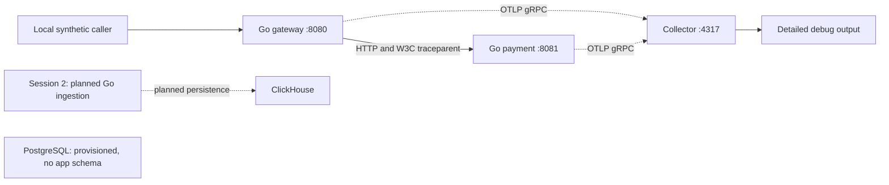

# Session 1 architecture

Only gateway, payment, Collector debug output and database provisioning are implemented. There is no TraceForge ingestion backend, storage writer, schema, query API, frontend, logs/metrics pipeline or RAG runner.

## Request and span lifecycle

`cmd/shop-demo` selects a service mode. `internal/telemetry` creates a provider with resource attributes, always-on sampling, batch processing and an OTLP/gRPC exporter. `internal/demo` receives HTTP through `otelhttp.NewHandler`. Gateway starts and ends a validation span, then calls payment with the original request context through `otelhttp.NewTransport`. Transport injects the outgoing client's trace context into W3C headers. Payment extracts that context, creates its server span and a manual processing span.

The hierarchy is gateway server → gateway client → payment server → payment processing. Gateway validation is another child of gateway server. IDs, not log order, establish relationships. A valid incoming caller context can make gateway a non-root span.

## OpenTelemetry vocabulary

- **TracerProvider:** owns the SDK configuration, resource, sampling and processors; creates tracers.
- **Tracer:** an instrumentation-scoped handle used to start spans.
- **Span:** one timed operation, including identity, parent, attributes, events and status.
- **SpanProcessor:** handles started/ended spans; the batch processor queues completed spans for export.
- **Exporter:** serializes/sends completed spans to the Collector using OTLP/gRPC.
- **Propagator:** extracts/injects context across HTTP headers; W3C Trace Context and Baggage are explicit here.

## Failure and lifecycle behavior

Payment simulation supports 0..2000ms delay and deterministic 503. Gateway maps payment failures to 502. The processing span and gateway span record safe fixed exceptions; HTTP instrumentation marks server/client errors. Network diagnostics are not copied into span exception messages. Request cancellation interrupts the delay. Gateway's client timeout is four seconds; servers have header/read/write/idle limits. Interrupt/SIGTERM initiates bounded HTTP draining followed by bounded provider shutdown.

SDK initialization validates local endpoint shape but is asynchronous and does not establish Collector connectivity. The default SDK error handler reports export failures to stderr. In-memory queues, default retry limits, crashes and abrupt termination can lose spans. Debug output has no persistence guarantee and may reveal synthetic URL metadata or propagated baggage. This session does not claim complete redaction, tenant security or production delivery semantics.

## Local infrastructure

Host ports 8080/8081/4317/8123/5432 bind to loopback. Only the demo uses HTTP; databases require generated local passwords from ignored `.env`. ClickHouse's readiness check executes authenticated SQL. PostgreSQL has `pg_isready` and an explicit authenticated SQL smoke check. Named volumes preserve database files. No application tables exist. Containers share a project-local Docker bridge network; they are not designed for untrusted workloads.

## Planned next step

Session 2 will add the custom OTLP receiver and ClickHouse persistence. It must explicitly define validation, acceptance, buffering and durability semantics rather than treating a debug log as durable storage.
