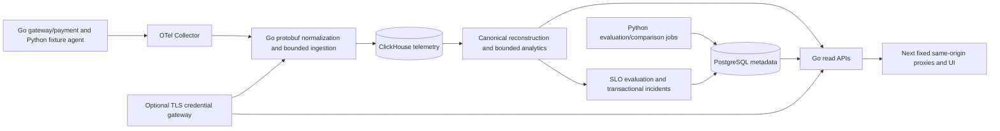

# Architecture and interview walkthrough

## Thirty seconds

TraceForge is a locally demonstrated observability and AgentOps platform built with Go, Python, OpenTelemetry, ClickHouse, PostgreSQL and Next.js. It stores traces/logs/metrics, reconstructs distributed requests, derives service analytics, persists reliability incidents, and links offline RAG evaluations to versioned release decisions. The engineering work centers on bounded ingestion, replay-safe measurement, metric temporality, immutable metadata and honest missing evidence. A controlled log index experiment reduced scan rows97.27% with about0.43% additional storage. This is a local engineering portfolio, not a production deployment or live-model quality claim.

## Two-minute architecture

The diagram abbreviates two mutually distinct local profiles. Legacy exposes loopback backends for the supported primary demos. Secure Compose removes those host mappings and routes authenticated traffic to separate fixed Alpha/Beta private processes, ClickHouse databases and PostgreSQL schemas. Each secure Collector represents exactly one owner. A user's OTLP attribute or browser query never selects that owner. See ADR0014 and the threat model for the actual trusted network/host assumptions; the simplified diagram is not a deployment instruction.

ClickHouse owns append-oriented telemetry: raw spans, raw log events, typed metric points and a log trace-ID bloom index. MergeTree keys order data; they do not enforce uniqueness. Canonical trace reconstruction groups logical span identities, selects deterministic equivalents/conflicts, exposes duplicates, and constructs roots/orphans/cycle diagnostics without inventing ancestry. RED counts canonical SERVER spans; graph edges require observed CLIENT→SERVER parent pairs. A request start population and an edge start population need not agree across boundaries.

Go ingestion normalizes bounded fields, reserves finite payload/work capacity, and returns successful direct OTLP export only after ClickHouse confirms persistence. Queued Collector export has an earlier volatile acceptance boundary. Retries can create physical replay rows; readers must remain replay-safe. No exactly-once claim follows from a persistence-confirmed acknowledgment.

Metrics use independent SDK instruments and OTLP transport, not span-derived counters disguised as complete traffic. The supported types are Gauge, Sum and explicit Histogram. Writer identity, cumulative/delta temporality, reset/predecessor availability, overlaps, bucket boundaries, overflow and rejected dimensions affect eligibility. Missing measurement remains unknown. Sampling selects trace populations and cannot turn them into complete-service availability.

PostgreSQL owns transactional/versioned evaluation datasets/runs/cases, paired comparisons, gate decisions, SLO definitions/evaluations, incidents/events and credentials. Immutable records and transactional incident transitions preserve evidence across retries, concurrent workers, restarts and UNKNOWN measurements. A firing incident survives missing evidence; only qualifying recovery resolves it.

Python retrieves a fixed synthetic corpus, bounds supplied context, executes a read-only owner-checked order tool where allowed, records canonical model/attempt/tool spans and hypothetical usage/cost, and evaluates a35-case constrained support dataset. Source prompts/context/answers are minimized out of telemetry. Dataset/configuration/prompt/corpus/pricing checksums distinguish runs. Exact offline facts/citations and coverage support diagnostic comparisons, not a general live-answer semantic score. Gates persist PASS/FAIL/INCONCLUSIVE with versioned policy and never deploy software.

Next displays backend decisions rather than recomputing scoring or incident arithmetic. Fixed same-origin proxies constrain upstreams and preserve explicit failures. React renders telemetry as text; nanosecond durations use exact integer handling. Security mode adds a private server-encrypted HttpOnly read cookie, online upstream revocation checks and no-store responses. Its browser runtime remains policy-blocked; successful lower-level checks are not promoted to browser evidence.

## Five-minute demonstration

Use reproducible-demos.md. Spend two minutes on Demo A's100 actual checkouts, graph, failed waterfall and correlated logs; show one persisted resolved incident and its separate measured SLO window. Spend two minutes on Demo B's frozen baseline/context regression, exact failed rule and both real trace links. Use the final minute to show the verification matrix, controlled scan benchmark and unresolved security/browser/advisory findings.

## Ten-minute technical discussion

1. Two minutes: explain acceptance versus persistence versus logical replay identity; show a duplicate that adds physical rows without changing canonical counts.
2. Two minutes: contrast trace RED with independent metric intervals, writer restart and histogram eligibility.
3. Two minutes: explain exact rational SLO budgets, concurrent incident transaction/revision behavior and UNKNOWN outage handling.
4. Two minutes: explain frozen evaluation provenance, numerator/denominator/coverage and an actual regressed case. Fixture cost is an estimate, never provider billing.
5. Two minutes: defend storage/index trade-offs and trusted tenant ownership; identify the unverified browser path and dependency exposure without claiming production readiness.

## Deliberate trade-offs

No Kafka was added: finite local memory queues and synchronous persistence satisfy the measured scope; a durable distributed queue would add delivery/replay/operation requirements without measured need. PostgreSQL was retained for transactional metadata rather than replacing ClickHouse analytics with row-store scans. A service-first ClickHouse layout harmed exact-trace scans/storage, so it remains experimental. ZSTD payload comparisons were confounded by synthetic repetition/merge state; snapshot preaggregation was not equivalent for conflicts. One core Go service avoids a separate deployment for every feature. Physical owner namespaces simplify comprehensive local tenant scope at the cost of provisioning/process scale and trusting one operator database principal.
